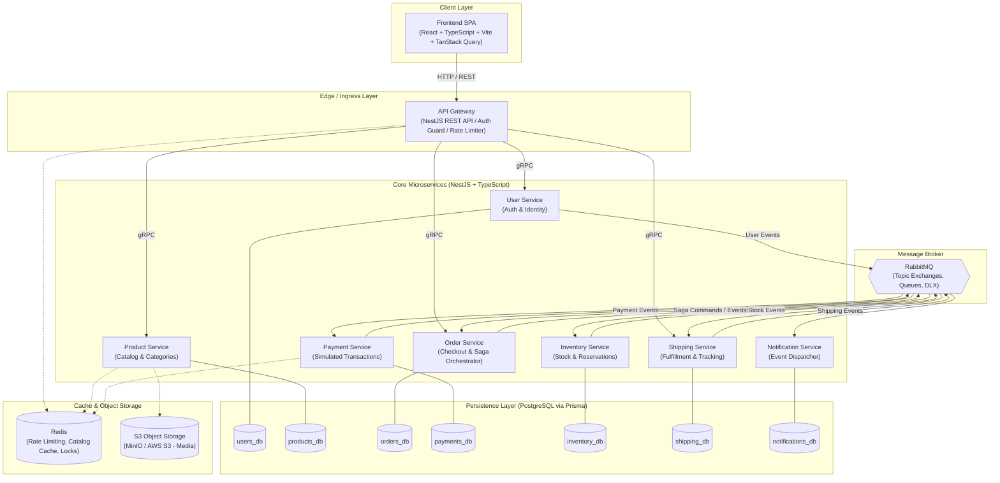
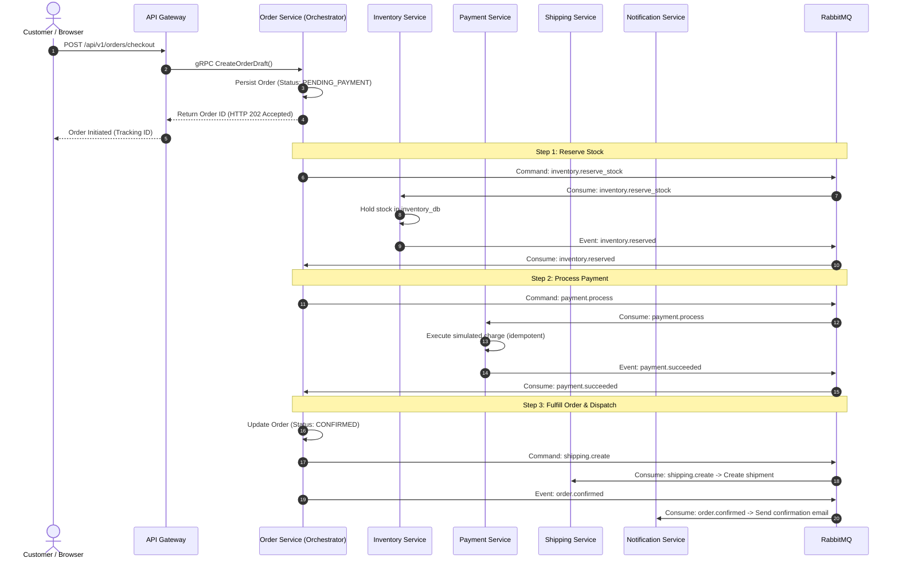
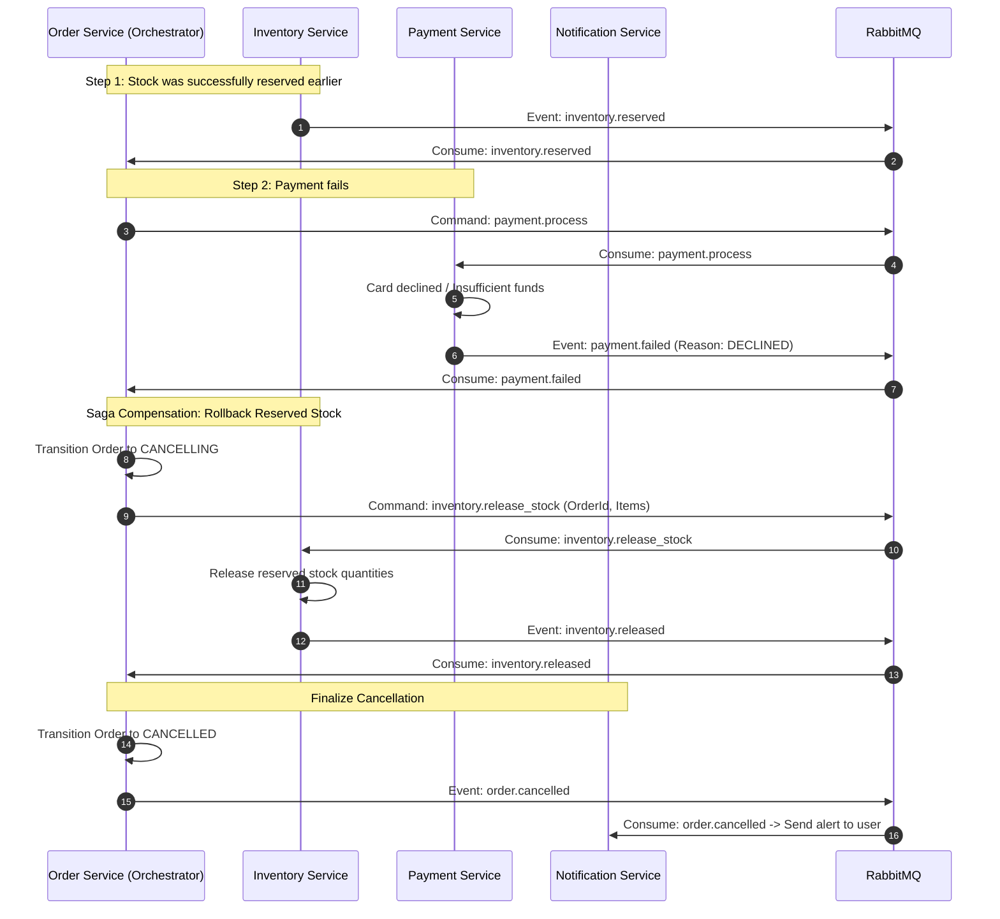

# ShopFlow — Master Architecture Blueprint

This document defines the system topology, service boundaries, communication protocols, and reliability patterns for ShopFlow.

**Implementation Status**: All backend services and infrastructure are currently **PLANNED**. Architecture specifications and design contracts are **VERIFIED** (Phase 1).

---

## 1. System Topology

---

## 2. Service Responsibilities & Database Ownership

ShopFlow strictly enforces the **Database-per-Service pattern**. Each microservice exclusively owns its database. Direct cross-database SQL queries, foreign keys, or shared schemas are prohibited.

| Application | Primary Responsibility | Persistent Datastore | Cache / Storage | External / Sync APIs | Async Queue Interfaces | Status |
| :--- | :--- | :--- | :--- | :--- | :--- | :---: |
| **API Gateway** | Reverse proxy, JWT auth validation, rate limiting, request correlation (`X-Correlation-Id`), error normalization (RFC 7807). No business logic. | *None (Stateless)* | Redis (Rate limits, denylist) | Inbound: Public REST Outbound: gRPC to User, Product, Order, Shipping | None | `PLANNED` |
| **User Service** | User registration, credential storage, Argon2id password hashing, JWT access and refresh token issuance. | `users_db` (Postgres) | Redis (Refresh tokens) | Inbound: gRPC (`GetUserById`, `ValidateToken`) | Outbound: `user.registered` | `PLANNED` |
| **Product Service** | Product catalog, categories, pricing, descriptions, and media metadata. | `products_db` (Postgres) | Redis (Catalog cache) MinIO/S3 (Images) | Inbound: gRPC (`GetProductById`, `CheckPricing`) | Outbound: `product.created`, `product.updated` | `PLANNED` |
| **Order Service** | Order lifecycle state machine, Checkout **Saga Orchestrator**, Transactional Outbox table. | `orders_db` (Postgres) | *None* | Inbound: gRPC (`GetOrderById`) | Outbound: Saga Commands Inbound: Domain Events | `PLANNED` |
| **Payment Service** | Simulated payment authorization, capture, refunds, and idempotency key enforcement. Zero real card storage. | `payments_db` (Postgres) | Redis (Idempotency locks) | *None (Async-First)* | Inbound: `payment.process` Outbound: `payment.succeeded`, `payment.failed` | `PLANNED` |
| **Inventory Service** | Warehouse stock tracking, temporary reservations during checkout, restock updates. | `inventory_db` (Postgres) | *None* | Inbound: gRPC (`GetStockLevels`) | Inbound: `inventory.reserve_stock`, `inventory.release_stock` | `PLANNED` |
| **Shipping Service** | Delivery address validation, carrier label generation simulation, parcel tracking stages. | `shipping_db` (Postgres) | *None* | Inbound: gRPC (`GetShipmentTracking`) | Inbound: `shipping.create` Outbound: `shipping.dispatched` | `PLANNED` |
| **Notification Service** | Asynchronous transactional notification dispatcher (emails, alerts). | `notifications_db` (Postgres) | *None* | *None (Async-First)* | Inbound: Subscribes to all platform domain events | `PLANNED` |

---

## 3. Communication Protocols: REST vs. gRPC vs. RabbitMQ

| Protocol | Scope | What It Does | Why It Exists | When to Use It |
| :--- | :--- | :--- | :--- | :--- |
| **REST (HTTP/JSON)** | Public Client Ingress | Client-to-Gateway communication. | Standard browser compatibility, cacheability, and RFC 7807 error responses. | Web and mobile clients accessing the platform API. |
| **gRPC (HTTP/2 + Protobuf)** | Internal Synchronous | Direct service-to-service point-to-point queries. | Binary serialization, strongly-typed contracts (`.proto`), connection multiplexing, and low latency. | When a caller cannot proceed without an immediate response (e.g., Gateway checking user profile or product price). |
| **RabbitMQ (AMQP 0-9-1)** | Internal Asynchronous | Transactional workflows, domain events, and Saga commands. | Decouples services, buffers load, guarantees at-least-once delivery, and isolates downstream failures. | Multi-service business processes (e.g., checkout, order fulfillment, notifications). |

---

## 4. Order Workflow, Saga Orchestration, and Reliability

Distributed transactions across independent microservices cannot use two-phase commit (2PC). ShopFlow uses the **Orchestrated Saga Pattern**, where the **Order Service** manages the checkout state machine.

### 4.1 Happy Path Checkout Flow

---

### 4.2 Failure Handling & Compensation (Payment Declined)

If payment fails, the Saga Orchestrator triggers **compensating transactions** to reverse previously completed steps:

---

### 4.3 Key Reliability Patterns

1. **Transactional Outbox Pattern**:
   * *Problem*: Dual-writing (saving to PostgreSQL and then publishing to RabbitMQ) risks data loss or phantom messages if a network error occurs between the database commit and the broker call.
   * *Solution*: The business record (`Order`) and the event (`outbox_messages`) are written in the **same local database transaction**. A background worker polls the outbox table and publishes events to RabbitMQ with persistent delivery.
2. **Idempotency**:
   * Commands must be safely retryable. Clients pass an `Idempotency-Key` header.
   * Payment Service stores this key with a unique constraint in `payments_db` and locks it in Redis during processing. Duplicate requests return the original result without re-executing charges.
3. **Eventual Consistency**:
   * Checkout returns `202 Accepted` immediately. The frontend polls or listens to server-sent events (SSE) while the Saga completes asynchronously in the background.

---

## 5. Security, Observability, and Storage Invariants

1. **Edge Authentication**: The API Gateway validates incoming JWT signatures, checks the Redis revocation denylist, and forwards verified identity claims via trusted internal headers (`X-User-Id`, `X-User-Roles`). Internal services do not repeat cryptographic JWT verification ([ADR-004](decisions/ADR-004-authentication.md)).
2. **Network Containment**: Internal microservices, databases, and message queues have no public internet routing. Only the API Gateway is exposed.
3. **Simulated Payment Security**: The platform strictly uses synthetic tokens (`tok_simulated_*`). Real credit card numbers and live payment credentials are never handled or stored.
4. **Binary Object Storage**: Media files (product images) are stored in S3-compatible storage (MinIO for local dev; AWS S3 for production). Databases store only object URLs and metadata.
5. **Request Correlation & Tracing**: Every request carries an `X-Correlation-Id` propagated across REST headers, gRPC metadata, RabbitMQ message headers, and structured JSON logs ([ADR-005](decisions/ADR-005-observability.md)).
6. **Health Checking**: Every service exposes `@nestjs/terminus` endpoints:
   * `/health/liveness`: Checks if the Node.js event loop is responsive.
   * `/health/readiness`: Probes database, RabbitMQ, and Redis connectivity before routing traffic.
