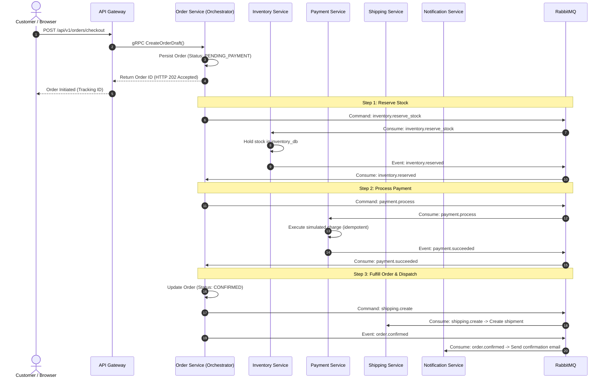
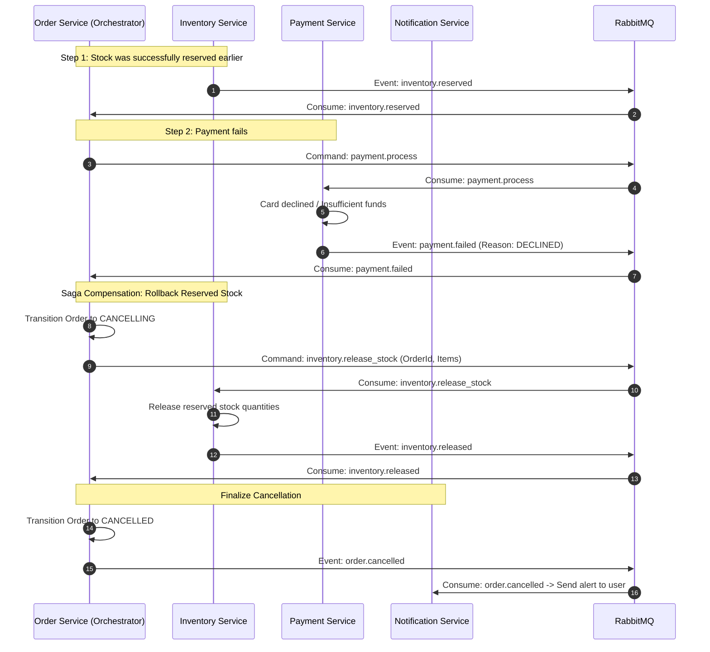

# Communication Flows, Saga Orchestration, and Reliability Patterns

## 1. Inter-Service Communication Strategy

ShopFlow utilizes a hybrid communication architecture tailored to latency, consistency, and resilience requirements:

| Pattern | Protocol | Use Case | Rationale |
| :--- | :--- | :--- | :--- |
| **Client to Ingress** | HTTP/REST (JSON) | External web browser / SPA to API Gateway | Standard browser interoperability, cacheability, RESTful conventions, RFC 7807 error responses. |
| **Internal Synchronous** | gRPC (HTTP/2 + Protobuf) | Low-latency queries (Gateway to User/Product/Order/Shipping) | Binary serialization, strongly-typed contracts (`.proto`), connection multiplexing, low CPU overhead. |
| **Internal Asynchronous** | RabbitMQ (AMQP 0-9-1) | Transactional workflows, domain events, Saga orchestration | Decoupling, guaranteed delivery, fault isolation, buffer capacity during peak loads. |

---

## 2. Asynchronous Architecture: RabbitMQ Topology

### 2.1 Exchanges and Routing Conventions
* **Exchange**: `shopflow.events` (Type: `topic`, Durable)
* **Exchange**: `shopflow.commands` (Type: `direct`, Durable)
* **Dead Letter Exchange (DLX)**: `shopflow.dlx` (Type: `fanout`, Durable)

Routing keys follow a standard hierarchical notation: `<domain>.<entity>.<action-in-past-tense>` or `<domain>.<entity>.<command>`:
* **Domain Events**: `user.user.registered`, `order.order.created`, `order.order.cancelled`, `inventory.stock.reserved`, `payment.transaction.succeeded`, `shipping.parcel.dispatched`
* **Saga Commands**: `inventory.reserve_stock`, `inventory.release_stock`, `payment.process`, `payment.refund`, `shipping.create`, `shipping.cancel`

### 2.2 Queues, DLX, and Retry Strategy
* Every consumer microservice binds its own private, durable queue to the exchange (e.g., `q.notification.all_events`, `q.inventory.reserve_commands`).
* **Message Durability**: All published messages have delivery mode set to `2` (persistent).
* **Consumer Acknowledgements**: Explicit manual acknowledgements (`ack` / `nack`) are strictly enforced. Auto-ack is disabled.
* **Retry and Poison-Pill Handling**:
  1. If processing fails due to a transient error, the consumer retries up to 3 times with exponential backoff (`x-retry-count` header).
  2. If the retry threshold is exceeded or a non-recoverable error occurs, the message is rejected with `requeue: false`, directing it into `shopflow.dlx` and onto a dedicated dead-letter queue (`q.dead_letter`) for alerting and operator inspection.

---

## 3. Order Saga Orchestration

Because distributed transactions cannot use two-phase commit (2PC) in an asynchronous microservices architecture, ShopFlow implements the **Orchestrated Saga Pattern**. The **Order Service** acts as the centralized Saga Orchestrator, coordinating state transitions across the **Inventory**, **Payment**, and **Shipping** services.

### 3.1 Happy Path Checkout Flow



---

### 3.2 Failure and Compensation Flow (Payment Declined)

If a downstream step fails (e.g., payment is declined), the Saga Orchestrator executes **compensating transactions** in reverse order to restore system consistency.



---

### 3.3 Inventory Depletion Failure (Out of Stock)

If stock cannot be reserved during Step 1:
1. Inventory Service checks stock levels and determines available quantity is below requested quantity.
2. Inventory Service emits `inventory.insufficient (OrderId, Sku, RequestedQty, AvailableQty)`.
3. Order Service Saga Orchestrator consumes the failure event.
4. Because no payment command was dispatched yet, no payment compensation is needed.
5. Order Service immediately transitions the order to `CANCELLED (Reason: INSUFFICIENT_STOCK)`.
6. Order Service publishes `order.cancelled` -> Notification Service notifies customer.

---

## 4. Reliability and Consistency Patterns

### 4.1 Transactional Outbox Pattern
Direct dual-writing (saving to PostgreSQL and then immediately publishing to RabbitMQ) is vulnerable to network splits and process crashes:
* If the database transaction commits but the network fails before RabbitMQ accepts the message, the event is permanently lost.
* If the event is sent first but the database rollback occurs, downstream services process phantom data.

**The Solution: Outbox Table**
1. When a business aggregate changes (e.g., creating an order), the entity state and an outbox event record are committed together in the **same local PostgreSQL transaction**:
   ```sql
   BEGIN TRANSACTION;
   INSERT INTO orders (id, status, ...) VALUES ('order-uuid', 'PENDING_PAYMENT', ...);
   INSERT INTO outbox_messages (id, aggregate_type, aggregate_id, event_type, payload, status)
   VALUES ('msg-uuid', 'Order', 'order-uuid', 'inventory.reserve_stock', '{"items": [...]}', 'PENDING');
   COMMIT;
   ```
2. A dedicated asynchronous outbox worker (within the service process) polls or streams `PENDING` outbox entries, publishes them to RabbitMQ with persistent delivery mode, and updates status to `PUBLISHED`.
3. Guarantees **at-least-once delivery** without distributed 2-Phase Commit (2PC).

### 4.2 Idempotency Mechanics
Because networks can duplicate packets and at-least-once delivery guarantees multiple deliveries in edge cases, all command consumers must be strictly idempotent:

* **Client Idempotency**: Checkout requests accept an `Idempotency-Key` header generated by the client (UUIDv4).
* **Payment Service**:
  * Stores `idempotencyKey` inside `payments_db` with a unique index constraint.
  * Uses Redis with a short TTL distributed lock (`SET idempotency:<key> px 10000 nx`) to avoid race conditions from parallel duplicate clicks.
  * If the key already exists and was processed, the cached response is returned without initiating a new transaction.
* **Inventory Service**:
  * Tracks `reservationId` keyed to `orderId`. Re-executing `inventory.reserve_stock` for the same order returns the existing reservation rather than reserving additional stock.

### 4.3 Eventual Consistency and State Synchronization
* In ShopFlow, cross-service state alignment is **eventually consistent**:
  * Upon checkout, the client receives an immediate `202 Accepted` response with the order identifier.
  * The frontend uses TanStack Query to poll the order status endpoint (`GET /api/v1/orders/:id`) or listens via server-sent events (SSE) while the Saga completes in the background.
  * Read projections (such as customer order history) reflect confirmed state once the outbox worker publishes the event and downstream subscribers process it.
