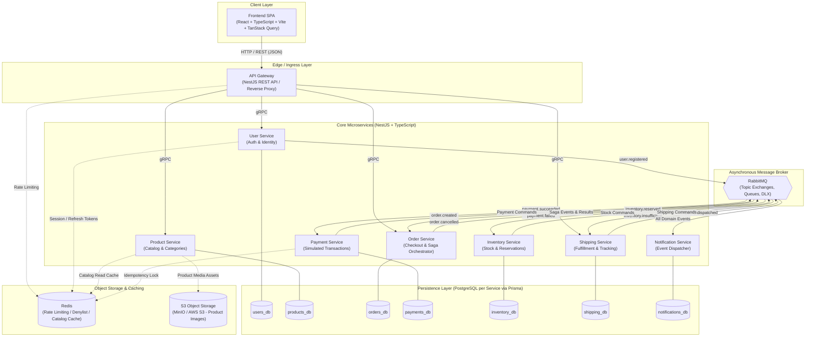

# ShopFlow System Architecture Overview

## 1. System Vision and Scope

ShopFlow is a production-style, learning-focused e-commerce microservices platform. The system demonstrates real-world distributed systems patterns, including strict service boundary isolation, asynchronous event-driven choreography and orchestration, the Transactional Outbox pattern, Saga orchestration with compensation, and resilient inter-service communication.

The platform separates client interactions, synchronous queries, and asynchronous transactional business flows into dedicated architectural layers.

---

## 2. System Topology



---

## 3. Component Architecture and Responsibilities

### 3.1 Client Layer
* **Frontend SPA**: Built with React, TypeScript, and Vite. Utilizes TanStack Query for server-state caching, optimistic updates, and background refetching. Communicates exclusively with the API Gateway via HTTP/REST.

### 3.2 Ingress / API Gateway
* **NestJS API Gateway**:
  * Acts as the single external entry point for all client traffic.
  * Handles TLS termination, CORS enforcement, and request rate limiting.
  * Validates JWT authentication signatures; extracts user identity and injects trusted internal headers (`X-User-Id`, `X-User-Roles`) to upstream microservices.
  * Generates or propagates `X-Correlation-Id` for distributed end-to-end request tracing.
  * Translates external HTTP/REST client requests into high-performance internal **gRPC** calls to downstream services (`User`, `Product`, `Order`, and `Shipping`).
  * Formats unified error responses according to RFC 7807 (Problem Details).
  * **Zero Business Logic Policy**: The Gateway does not calculate order totals, process payments, or inspect inventory rules.

### 3.3 Core Microservices
* **User Service**: Manages customer profiles, credentials, password hashing, and authentication tokens (JWT issuance and refresh rotation).
* **Product Service**: Manages product items, categories, descriptions, images, and prices. Backed by Redis for high-speed read caching and object storage for binary media.
* **Order Service**: Coordinates checkout workflows, acts as the Saga Orchestrator for distributed order processing, and maintains order status history.
* **Payment Service**: Encapsulates payment transactions with strict idempotency key tracking. Integrates simulated payment processing without storing real credentials.
* **Inventory Service**: Manages physical warehouse stock, handles reservations during checkout, and releases reservations upon order cancellation.
* **Shipping Service**: Manages delivery addresses, calculates shipping options, coordinates carrier dispatching (simulated), and tracks package stages.
* **Notification Service**: Purely event-driven service listening for domain events to send transactional emails, SMS, or mock notifications.

---

## 4. Cross-Cutting Technical Patterns

### 4.1 Authentication and Identity Propagation
* **Token Issuance**: The User Service validates credentials and signs asymmetric or symmetric JSON Web Tokens (JWT).
* **Gateway Validation**: The API Gateway acts as the authentication boundary. It verifies incoming `Authorization: Bearer <token>` headers against cryptographic signatures and the Redis denylist.
* **Header Propagation**: Downstream microservices do not repeat cryptographic token validation. Instead, the Gateway forwards authenticated context using standard trusted headers:
  * `X-User-Id`: Subject identifier (UUID).
  * `X-User-Email`: User's primary email.
  * `X-User-Roles`: Comma-separated roles (e.g., `customer,admin`).
* **Inter-Service Calls**: Synchronous internal gRPC calls carry security metadata in gRPC `Metadata` headers.

### 4.2 Configuration Management
* Standardized using `@nestjs/config` across all applications.
* **Schema Validation**: Environment variables are strictly validated on service startup using Joi or Zod schemas. If a required environment variable is missing or malformed, the process immediately crashes with a clear diagnostic error (Fail-Fast principle).
* Layered defaults ensure services run out of the box with reasonable local defaults while remaining configurable via environment variables in containerized environments.

### 4.3 Structured Logging and Request Correlation
* **Correlation ID**: Every request entering the API Gateway is tagged with an `X-Correlation-Id` (UUIDv4). If a client provides one, it is retained; otherwise, a new one is generated.
* **Propagation**:
  * Transferred across internal HTTP/gRPC requests via headers/metadata.
  * Embedded in RabbitMQ message headers (`headers['x-correlation-id']`).
* **Structured Logs**: All services emit logs in structured JSON format with standard fields:
  ```json
  {
    "timestamp": "2026-10-14T12:00:00.000Z",
    "level": "INFO",
    "service": "order-service",
    "correlationId": "f47ac10b-58cc-4372-a567-0e02b2c3d479",
    "context": "OrderSagaOrchestrator",
    "message": "Stock reservation command dispatched for order ORD-1092"
  }
  ```

### 4.4 Health Checks: Liveness vs. Readiness
Each service exposes health check endpoints under `/health` using `@nestjs/terminus`:
* **Liveness Probe (`/health/liveness`)**:
  * Verifies only that the application process is running and the Node.js event loop is responding.
  * Does NOT test downstream dependencies. If this fails, the orchestrator (Docker/Kubernetes) should restart the container.
* **Readiness Probe (`/health/readiness`)**:
  * Verifies whether the service can actively serve traffic.
  * Tests connections to the service's dedicated PostgreSQL database (via Prisma `$queryRaw` ping), connection to RabbitMQ, and Redis connectivity.
  * If this fails, traffic routing to this instance is temporarily paused without terminating the process.

### 4.5 Error Handling and Fault Tolerance
* **Client-Facing Errors**: The API Gateway catches internal exceptions and translates them into standardized RFC 7807 **Problem Details**:
  ```json
  {
    "type": "https://api.shopflow.dev/errors/out-of-stock",
    "title": "Insufficient Inventory",
    "status": 409,
    "detail": "Requested quantity for item PRD-402 exceeds available stock.",
    "instance": "/api/v1/orders/checkout",
    "correlationId": "f47ac10b-58cc-4372-a567-0e02b2c3d479"
  }
  ```
* **Internal gRPC Errors**: Microservices return standard gRPC status codes (`NOT_FOUND`, `INVALID_ARGUMENT`, `ALREADY_EXISTS`, `UNAVAILABLE`) rather than arbitrary internal stack traces.
* **Resilience**: Client calls from the Gateway implement explicit request timeouts (e.g., 3000ms) and retry policies for transient network failures.

---

## 5. Security, Storage, and Data Protection Invariants

1. **Strict Data Isolation**: No microservice may connect to or query a database owned by another microservice. Data sharing occurs exclusively via APIs (gRPC) or asynchronous events (RabbitMQ).
2. **Private Network Containment**: Backend microservices and databases have no public internet routing. Only the API Gateway is publicly reachable.
3. **Secret Hygiene**: Real credentials, private keys, or tokens must never be committed to Git. All secrets are injected at runtime via environment variables validated on boot.
4. **Binary Object Storage**: Media files (product images, invoice PDFs) are never stored in relational databases. They are streamed to an S3-compatible object store (MinIO locally; AWS S3 in production).
5. **Payment Security & Simulation**: Payment operations are strictly simulated using synthetic tokens (`tok_simulated_*`). Real credit card data and live banking credentials are prohibited from all environments.
6. **Immutable Audit Trails**: High-value domain mutations (orders, payment captures, stock changes) produce append-only audit records tagged with `timestamp`, `actorId`, and `correlationId`.
